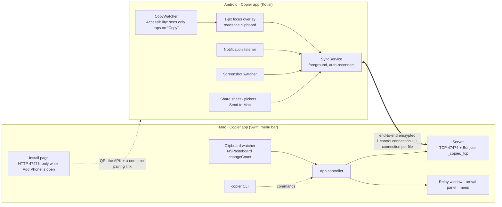
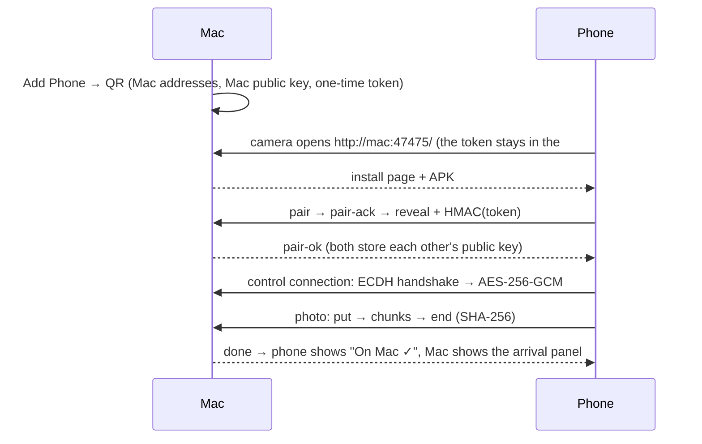

# Copier

**Phone Link / AirDrop for Mac + Android.** Copy on one device, paste on the other. Send photos and
files both ways, see your phone's notifications on the Mac, ring your phone, open links across
devices, all end-to-end encrypted, over your own Wi-Fi, with no cloud and no account.

Setup is one terminal line on the Mac and one QR scan on the phone.

```sh
curl -fsSL https://raw.githubusercontent.com/Shivam909058/copier/main/install.sh | bash
```

**Using an AI coding agent?** Give it this repository's link and say *"set up Copier"*. Claude Code,
Codex, Cursor and similar agents follow [AGENTS.md](AGENTS.md): they install the Mac app, walk you
through the few taps only you can do, wait for your phone to connect, test both directions, and fix
what's broken. In Claude Code you can also run `/setup-copier` inside the repo.

---

## Contents

- [Features](#features)
- [Install](#install)
- [First-run checklist](#first-run-checklist)
- [Everyday use](#everyday-use)
- [The `copier` command](#the-copier-command)
- [How it works](#how-it-works)
- [Troubleshooting](#troubleshooting)
- [Privacy and security](#privacy-and-security)
- [Build from source](#build-from-source)
- [Releasing](#releasing)
- [Uninstall](#uninstall)

---

## Features

### Mac → phone

- **Copy anything** (text, links, formatted text) and it's on the phone's clipboard automatically.
- **Copy an image** and paste it on the phone (WhatsApp, Gmail, anywhere).
- **Copy files in Finder** (up to 50 MB) and they land in the phone's `Download/Copier` folder.
- **Send files of any size:** drop them on the Copier window or menu-bar icon, right-click → Services
  → *Send to Phone*, *Send Files…*, or `copier send`.
- **Password-manager items** sync but arrive marked sensitive (hidden preview on Android 13+).
- **Open on Phone:** links open in the phone's browser; `localhost:3000` is rewritten to the Mac's
  address so your dev server opens on the phone.
- **Ring Phone:** a loud alarm for 30 s, even on silent.
- **Reply to phone notifications** (WhatsApp, SMS…) and dismiss them, or tap their buttons (decline a
  call), from the Mac.
- **Delivery status** for everything: *Sending 62 %*, then *On phone ✓*.

### Phone → Mac

- **Tap Copy anywhere** and it's on the Mac's clipboard. Nothing else to press (see
  [how](#how-zero-tap-copy-works)).
- **"Copy image"** puts the image on the Mac's clipboard.
- **Take a screenshot** and it's on the Mac's clipboard (⌘V) and in Downloads instantly.
- **Share → Send to *your Mac*** (top row of the share sheet): photos and files, many at once, any size.
- **Send photos / Send files** buttons in the Copier app.
- **Select text → Send to Mac** in the text-selection menu.
- **Share a link → Open on Mac** opens it in the Mac's browser.
- **Notifications and calls** show on the Mac (window, and banners if macOS notifications are on).
- **One-time codes** from notifications are copied to the Mac (best effort; see the
  [troubleshooting](#troubleshooting) table).
- **Battery** level and charging state in the Mac's menu bar and window.
- **Delivery status** for everything: *Sending…*, then *On Mac ✓*.

### Both

- **QR setup:** scan, install, pair. No codes, no cable, no developer options.
- **End-to-end encryption** with forward secrecy; only your paired devices can connect.
- **Auto-reconnect** within about a second after Wi-Fi changes or the Mac waking up.
- **Relay timeline on both devices:** the other device's items on one side, yours on the other, each
  with its real state. History survives restarts; passwords are never stored.
- **Arrival panel** on the Mac: photos, files, screenshots and codes pop up with **Open** / **Show in
  Finder**, even when notifications are off.
- **Menu bar:** status, battery, the last five items (one click to copy or open), quick actions.
- **`copier` in the terminal:** `start`, `doctor`, `qr`, `send`, `copy`, `paste`, `open`, `ring`.
- **Fallbacks:** a Quick Settings tile and a notification button send the phone's clipboard with one tap.

---

## Install

You need a Mac on **macOS 14+** and an Android phone on **Android 10+**, both on the **same Wi-Fi**
(or the Mac joined to the phone's hotspot).

### 1. Mac (one line)

```sh
curl -fsSL https://raw.githubusercontent.com/Shivam909058/copier/main/install.sh | bash
```

This downloads the latest release, verifies its checksum, installs **Copier.app**, links the
`copier` command and opens Copier. With no phone paired yet, the **Add Phone** window opens with a QR code.

### 2. Phone (one scan)

1. **Turn off Play Protect for a minute.** Copier uses Android's Accessibility and notification
   access, and Play Protect blocks browser-installed apps that ask for them ("App can't be installed").
   Play Store → your profile photo → **Play Protect** → ⚙ → *Scan apps with Play Protect* → **Off**.
2. **Scan the QR code** with the phone's camera. A page opens on the phone.
3. Tap **1 · Install Copier**. If Chrome says the download isn't secure, tap **Keep** (it's coming
   straight from your Mac over your network). Allow the browser to install apps if Android asks.
4. Go back to the page and tap **2 · Open Copier to pair**, then **Pair**. The Mac window shows ✓.
5. Turn Play Protect back on.

Lost the QR window? Menu bar → **Add Phone…**, or `copier qr` (prints it in the terminal too).

---

## First-run checklist

Each item is asked once. Copier's phone app has a **Setup** section that walks through the phone
side and collapses to *Setup ✓* when done.

| Where | What | Why |
|---|---|---|
| Mac | System Settings → Privacy & Security → **Paste from Other Apps** → Copier → **Always Allow** | macOS 26 asks before any app reads the clipboard in the background. Until then, Mac → phone sync pauses and the menu shows **⚠︎ Allow Clipboard Access…** |
| Mac | Allow **notifications** | Banners for arriving files and phone notifications. Optional: the arrival panel works without them. |
| Mac | Allow access to **Downloads** | Received files are saved there. |
| Phone | Notifications → **Allow** | The connection notification and "received" alerts. |
| Phone | Battery → **Allow background activity** and **Auto launch** (Realme, OPPO, OnePlus, Xiaomi, Vivo) | These phones stop background apps, which stops sync. |
| Phone | Accessibility → **Copier — send copies to Mac** → On | Makes phone → Mac copy automatic. If it's greyed out: App info → ⋮ → **Allow restricted settings**, then try again. |
| Phone | **Notifications on Mac** (Notification access) → Copier → On | Mirrors notifications and calls to the Mac. |
| Phone | Photos → **Allow all** | Sends screenshots to the Mac automatically. ("Select photos" isn't enough.) |

---

## Everyday use

| You want to… | Do this |
|---|---|
| Paste on the phone what you copied on the Mac | Just paste. |
| Paste on the Mac what you copied on the phone | Just paste (⌘V). |
| Send a photo from the phone | Share → **Send to *your Mac*** → it's in Downloads, with a panel to open it. |
| Send a file from the Mac | Drop it on the Copier window or menu-bar icon. |
| Get a phone screenshot into a doc, Slack or a bug report | Take the screenshot, then ⌘V on the Mac. |
| See everything that crossed, and whether it arrived | Menu bar → **Open Copier** (or open Copier.app again). |
| Reply to a WhatsApp message from the Mac | Open Copier → *Notifications* → type in **Reply**, or reply from the banner. |
| Find your phone | Menu bar → **Ring Phone**. |
| Test your local dev server on the phone | `copier open localhost:3000`. |

Received files go to `~/Downloads` on the Mac and `Download/Copier` on the phone.

---

## The `copier` command

Installed by the installer (or menu → Advanced → *Install Command-Line Tool*).

| Command | What it does |
|---|---|
| `copier start` | Brings everything up: launches Copier, refreshes the network announcement, waits for the phone, and prints a QR to re-pair if it doesn't connect. `--restart` restarts the app first. **Run this whenever something seems stuck.** |
| `copier doctor` | Checks each link in the chain and tells you the fix for anything broken. |
| `copier qr` | Shows the pairing QR in the terminal and on screen. |
| `copier status [--json]` | Phone, connection and battery. |
| `copier send <file>…` | Sends files to the phone. |
| `copier copy [text]` | Puts text on the phone's clipboard (reads stdin if no text: `cat log.txt \| copier copy`). |
| `copier paste` | Prints the latest text copied on the phone (`copier paste > notes.txt`). |
| `copier open <url>` | Opens a link on the phone; `localhost` becomes the Mac's address. |
| `copier ring` | Rings the phone. |
| `copier history [n]` | The last *n* items that crossed. |
| `copier stop` | Quits Copier. |

---

## How it works

### Components



- The **Mac listens**, the **phone dials**. The phone finds the Mac with Bonjour (or the addresses in
  the QR) and reconnects on its own.
- One long-lived **control** connection carries clipboard text, receipts, notifications, battery and
  commands. Every photo or file gets its **own** connection, so a 2 GB video never delays a copy.
- Files are written to a temporary file, checked against a SHA-256 hash, then moved into place.
  Existing files are never overwritten.

### Setup and a transfer, end to end



The wire format is documented in [PROTOCOL.md](PROTOCOL.md). Both apps are tested against the same
crypto test vectors ([testvectors/v1.json](testvectors/v1.json)), and a cross-language test drives
the phone's real networking code against the real Mac server.

### How zero-tap copy works

Since Android 10, apps can't read the clipboard in the background. Copier's Accessibility service
watches only for taps on controls labelled **Copy** (the text-selection toolbar, WhatsApp's copy icon,
"Copy link", "Copy image"…). It can't read the screen: `canRetrieveWindowContent` is off. On such a
tap, a 1-pixel invisible window takes focus for a split second, reads the clipboard, and sends it.
Android may show "Copier pasted from your clipboard" each time; that's expected.

---

## Troubleshooting

Start with **`copier doctor`** on the Mac: it checks everything below and prints the fix.
**`copier start`** fixes most "it stopped working" cases in one go.

| Symptom | Cause | Fix |
|---|---|---|
| Phone: **"App can't be installed"** / "App blocked to protect your device" | Play Protect blocks browser-installed apps that use Accessibility or notification access | Turn off Play Protect while installing (Play Store → profile → Play Protect → ⚙), install, turn it back on. Needed for each update. |
| Phone: **"App was denied access"**, Accessibility toggle greyed out | Android's *restricted settings* for sideloaded apps | Settings → Apps → Copier → **⋮** (top right) → **Allow restricted settings**, then turn the toggle on. |
| Phone: copying does nothing on the Mac | Accessibility toggle off, or Copier isn't connected | Check *Setup* in the phone app; run `copier doctor`. Meanwhile, the Quick Settings tile or the notification's **Send clipboard** button works with one tap. |
| Phone stops syncing after a while | The phone's battery manager stopped Copier | Settings → Apps → Copier → Battery → **Allow background activity** + **Auto launch**; turn battery optimization off. |
| QR page doesn't open on the phone | Not on the same network, or Wi-Fi isolates devices (common in offices, colleges, hotels) | Join the Mac to the phone's hotspot, then `copier qr` (a fresh QR with the new address). |
| Mac: copying stopped reaching the phone | macOS paste privacy is set to *Ask* | System Settings → Privacy & Security → **Paste from Other Apps** → Copier → **Always Allow**. |
| Mac: no alert when a file arrives | macOS notifications are off for Copier | System Settings → Notifications → Copier → Allow. The arrival panel still shows either way. |
| Chrome: "this file can't be downloaded securely" | The APK comes over plain HTTP from your Mac | Tap **Keep**. Do the install on a network you trust. |
| Mac: "Copier can't be opened" | The zip was downloaded in a browser, so macOS quarantined it | Use the one-line installer, or right-click Copier.app → **Open** → Open. |
| Nothing syncs after a Wi-Fi change | Stale connection or announcement | `copier start` (refreshes the network side and waits for the phone). |
| One-time codes aren't copied | Android 15+ hides OTP text from third-party apps | Expected; codes the phone does show are copied. |
| Phone: update says the package conflicts | The installed app was signed by a different build (for example, self-built vs. release) | Uninstall Copier on the phone, install from the QR again, and pair again. |
| Two entries for the same phone on the Mac | The phone app was reinstalled (new keys) | Menu → Paired Phones → unpair the old one. |
| Where are my files? | — | Mac: `~/Downloads`. Phone: `Download/Copier`. Everything is also in the Copier window's timeline. |

**Logs** never contain clipboard or file contents:

```sh
/usr/bin/log stream --level info --predicate 'subsystem == "dev.copier"'   # Mac
adb logcat -s Copier                                                       # phone, if you use adb
```

Use `/usr/bin/log`: zsh has a built-in `log` command that hides the real one.

---

## Privacy and security

- **No cloud, no account.** Data moves directly between your devices on your network.
- **Pairing:** the QR carries the Mac's public key and a one-time secret (single use, 10-minute
  lifetime) that never crosses the network. Manual pairing uses a 6-digit code compared on both screens.
- **Every connection** does a fresh P-256 key exchange mixed with the paired keys (HKDF-SHA256) and
  encrypts with AES-256-GCM. Only paired devices can complete the handshake; old traffic stays safe if a
  key leaks later.
- **Passwords** from password managers are marked sensitive, never logged, and never saved to history.
  Phone notifications are kept in memory only.
- **The install page** (HTTP, port 47475) runs only while Add Phone is open, and serves nothing secret.
  The APK download itself is plain HTTP on your network, so install on a network you trust.
- **The Accessibility service** sees only the label of the button you tap, never the screen.

---

## Build from source

Requirements: Xcode 16+, JDK 21+, Android SDK (platform 36, build-tools 36).

```sh
# Android (signed with your debug key unless COPIER_KEYSTORE is set)
cd android && ./gradlew test assembleRelease

# Mac: builds Copier.app with the APK above inside, signed with your Apple Development identity
cd ../mac && swift test && ./scripts/build-app.sh
open build/Copier.app
```

More tests:

```sh
cd mac && COPIER_INTEROP=1 swift test --filter Interop          # Kotlin client ⇄ Swift server
cd mac && COPIER_SNAPSHOT=/tmp/relay.png swift test --filter Snapshot   # renders the window to a PNG
```

`testvectors/v1.json` pins every crypto output; regenerate it only for an intentional protocol change:
`cd mac && COPIER_RECORD_VECTORS=1 swift test`.

Layout: `mac/` (SwiftPM: `CopierCore` protocol library, `Copier` app, `copier-cli`), `android/`
(Gradle, platform APIs only), `PROTOCOL.md`, `testvectors/`, `docs/` (design notes).

---

## Releasing

Push a version tag; GitHub Actions builds, tests, signs and publishes both apps:

```sh
git tag v0.3.1 && git push origin v0.3.1
```

The release contains `Copier-<version>-macOS.zip` (universal, with the APK inside),
`Copier-<version>-android.apk` and `SHA256SUMS`. The installer always fetches the latest release.

Repository secrets used by the workflow:

| Secret | What |
|---|---|
| `ANDROID_KEYSTORE_B64` / `ANDROID_KEYSTORE_PASSWORD` | The Android release key (base64) and its password. Keep a backup: losing it means users must reinstall to update. |
| `MAC_SIGNING_P12_B64` / `MAC_SIGNING_P12_PASSWORD` | The self-signed "Copier Code Signing" identity (base64 .p12). Its public certificate is `mac/signing/copier-code-signing.pem`. A stable signature keeps macOS permissions across updates. |

---

## Uninstall

```sh
curl -fsSL https://raw.githubusercontent.com/Shivam909058/copier/main/install.sh | bash -s -- --uninstall
```

On the phone, uninstall Copier like any other app.

---

MIT licensed. See [LICENSE](LICENSE).
